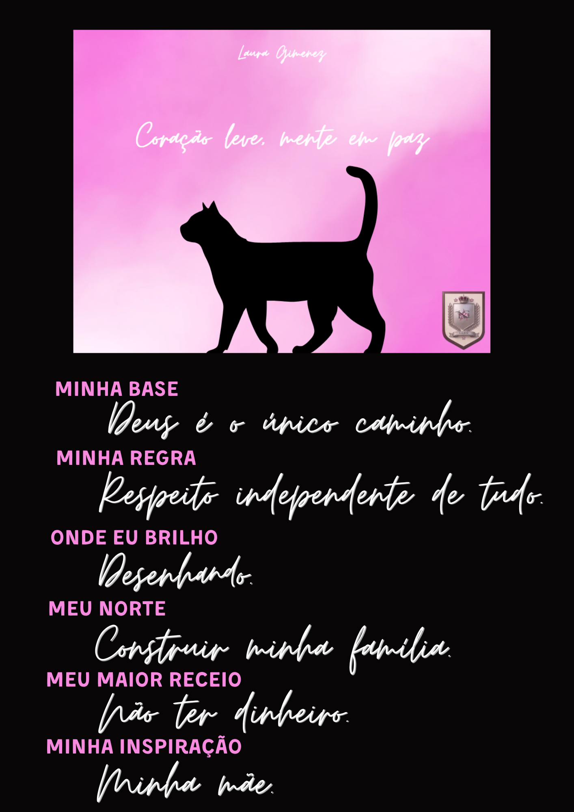

# capa-do-meu-album

Material da disciplina de Autoconhecimento feito no Canva para refletir meus princípios.

---

## 🎨 Elementos da Capa

* **Título do álbum:** *"Coração leve, mente em paz"* — Representa o meu estado atual e a busca constante por equilíbrio emocional.
* **Nome artístico:** *Laura Gimenez* — Meu próprio nome, assumindo a autoria da minha história.
* **Imagem central:** *Silhueta de um gato* — Simboliza independência, tranquilidade e intuição.
* **Paleta de 3 cores:** *Rosa, branco e preto* — Trazendo o contraste entre a suavidade/leveza (rosa e branco) e a firmeza/profundidade (preto).
* **Fundo:** *Degradê em tons de rosa* — Remete a uma atmosfera acolhedora e calma.
* **Selo:** *Brasão no canto inferior direito* — Representa os objetivos que carrego comigo.

---

## 🎵 Tracklist (As 5 Faixas)

1. **Faixa 1 — Minha Base (Crença):** *"Deus é o único caminho."*
2. **Faixa 2 — Minha Regra (Valor):** *"Respeito independente de tudo."*
3. **Faixa 3 — Onde eu Brilho (Talento):** *"Desenhando."*
4. **Faixa 4 — Meu Maior Receio (Medo):** *"Não ter dinheiro."*
5. **Faixa 5 — Meu Norte (Sonho):** *"Construir minha família."*

* **Faixa Bônus / Inspiração:** *"Minha mãe"* — A grande referência que impulsiona toda essa jornada.
